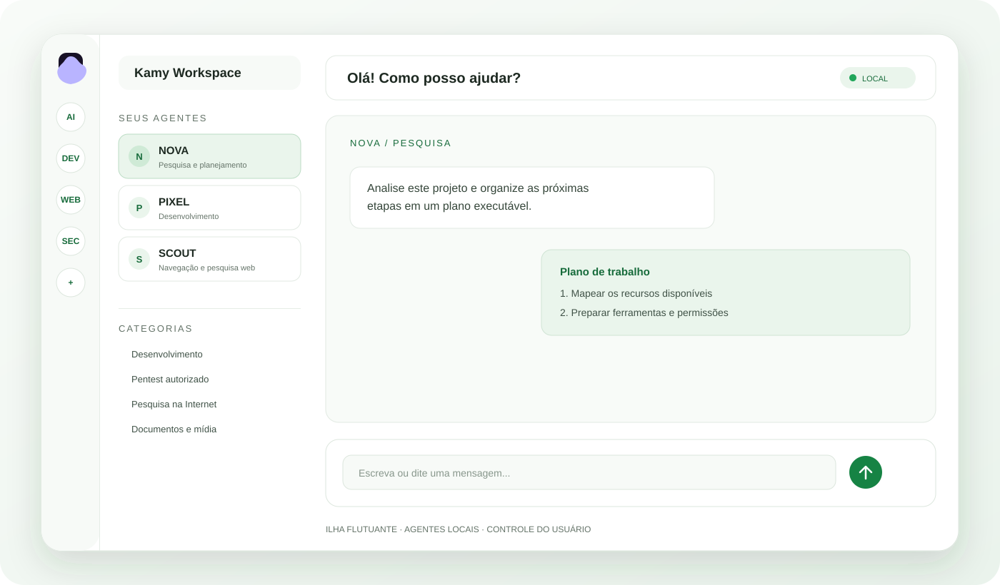
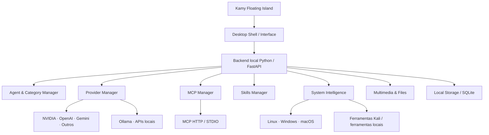

<div align="center">
  
  <h1>KAMY</h1>
  <p><strong>Personal AI Environment · Ilha flutuante · Agentes · Ferramentas locais</strong></p>
  <p>Open source · Local-first · Uso individual · Multiplataforma (objetivo)</p>
  
  <p><a href="#visão-geral">Visão geral</a> · <a href="#interface-ilha-flutuante">Interface</a> · <a href="#agentes-e-categorias">Agentes</a> · <a href="#system-intelligence-kali-linux">Kali Linux</a> · <a href="#instalação">Instalação</a> · <a href="#roadmap">Roadmap</a></p>
</div>

---

## Visão geral

**Kamy é um ambiente pessoal de inteligência artificial que reúne modelos de IA, agentes especializados, ferramentas do sistema, integrações MCP, Skills e recursos multimodais em uma interface flutuante.**

A ideia é transformar o Kamy em uma central de comando para o computador: você abre a ilha por um comando ou pela bandeja do sistema, escolhe um agente e conversa com ele. Conforme as permissões concedidas, o agente poderá pesquisar, programar, analisar arquivos, interagir com ferramentas locais e executar fluxos de trabalho.

O Kamy não deve ser apenas um chatbot com vários personagens. A proposta é ser um ambiente extensível no qual **o usuário escolhe os provedores, cria os agentes, conecta suas próprias ferramentas e controla os dados e permissões**.

### Princípios do projeto

- **Individual e local:** uma instalação para uma pessoa, controlada pelo próprio usuário.
- **Sem plataforma multiusuário:** não há contas compartilhadas, painel de administrador, operador central ou serviço hospedado obrigatório.
- **Local-first:** configurações, conversas, memória, Skills, inventário e integrações ficam na máquina do usuário, salvo quando uma função precisa enviar dados a um provedor externo escolhido.
- **BYOK (Bring Your Own Key):** o usuário configura suas próprias chaves e contas de API.
- **Extensível:** agentes, provedores, MCPs e Skills podem ser adicionados conforme a necessidade.
- **Multiplataforma:** Linux, Windows, macOS e Android fazem parte do objetivo do projeto. Nem todos os recursos nativos estão disponíveis em todas as plataformas ainda.

> **Estado atual:** o repositório já possui uma aplicação local com backend Python/FastAPI, interface web local, janela desktop Electron, bandeja do sistema, agentes iniciais, integração NVIDIA NIM, armazenamento local, permissões, Skills declarativas e suporte MCP. O inventário abrangente de ferramentas do Kali, backup/restauração portátil, novos provedores, geração multimídia e experiência Android nativa são etapas de evolução descritas neste documento — não devem ser consideradas concluídas apenas por estarem documentadas.

## Interface: ilha flutuante

A interface toma como referência o conceito de uma ilha de desktop, não de um site que o usuário precisa abrir manualmente.

- **Modo compacto:** uma pequena ilha flutuante sobre o desktop.
- **Modo expandido:** abre o ambiente completo, com conversas, agentes, ferramentas, arquivos e configurações.
- **Sempre visível:** opção de manter a janela acima das demais, quando o sistema gráfico permitir.
- **Bandeja do sistema:** mostrar/ocultar, expandir/recolher e encerrar o aplicativo.
- **Seletor de agentes:** troca rápida entre agentes e categorias.
- **Voz:** entrada por microfone, com transcrição para a conversa; recursos de voz avançados dependem do suporte do sistema e do provedor.
- **Anexos:** área para enviar arquivos e mídias para análise.
- **Tema:** identidade clara com superfícies claras, texto legível e acentos inspirados no mascote oficial azul, ciano, rosa e lilás.

No Linux, alguns compositores Wayland limitam o controle de posição e comportamento always-on-top. O aplicativo deve informar essas limitações em vez de prometer um comportamento que o compositor não oferece.

## Agentes e categorias

As bolinhas da barra lateral representam **categorias**. O usuário poderá criar, renomear, reorganizar e remover categorias, além de criar quantos agentes pessoais desejar.

Categorias sugeridas:

| Categoria | Exemplos de tarefas |
|---|---|
| Development | Programação, revisão de código, debugging, testes e arquitetura |
| Cybersecurity | Inventário, análise de segurança e testes autorizados |
| Research | Pesquisa na Internet, comparação de fontes e síntese |
| Automation | Automação de tarefas e fluxos de trabalho |
| Finance | Consulta e análise de informações financeiras |
| Creative | Ideias, imagens, vídeos, áudio e documentos |
| Custom | Agentes e especialidades definidos pelo usuário |

Cada agente deverá poder ter:

- Nome, avatar, descrição e instruções de sistema próprias.
- Categoria e identidade visual próprias.
- Provedor e modelo de IA selecionados.
- Memória e histórico separados.
- Skills habilitadas.
- Servidores MCP e ferramentas autorizados.
- Acesso a arquivos e diretórios explicitamente permitidos.
- Permissões de execução e nível de autonomia configuráveis.

Exemplos de agentes que o usuário pode criar:

- **NEMESIS:** especialista em cibersegurança e ferramentas de análise.
- **PIXEL:** desenvolvimento, programação e revisão de código.
- **SCOUT:** pesquisa e navegação na Internet.
- **NOVA:** assistente geral e coordenação de tarefas.

Esses nomes são exemplos de configuração, não agentes obrigatórios nem contas separadas.

## Gerenciador de provedores e modelos de IA

O Kamy deve ser independente de um único fornecedor. O usuário configura suas próprias credenciais e escolhe o modelo padrão ou um modelo por agente.

Provedores desejados:

- NVIDIA NIM.
- OpenAI API.
- Google Gemini.
- Anthropic.
- OpenRouter.
- APIs compatíveis com OpenAI.
- Modelos locais via Ollama e servidores com API compatível.

A arquitetura de provedores deve padronizar mensagens, streaming, ferramentas, anexos e metadados, respeitando as diferenças de cada API. Nem todo modelo oferece visão, áudio, geração de imagem, vídeo ou chamadas de ferramentas.

**Implementação atual:** integração com NVIDIA NIM/Chat Completions e configuração de modelo/chaves. Os demais provedores são objetivos de expansão e devem ser adicionados com adaptadores e testes próprios.

As chaves devem ser armazenadas localmente com criptografia em repouso. O Kamy não deve incluir chaves de API no código, README, logs ou commits.

## System Intelligence: Kali Linux e ferramentas locais

Um dos módulos centrais planejados é o **System Intelligence**, responsável por mapear o ambiente no qual o Kamy está instalado.

### Inventário do sistema

O scanner deverá detectar, quando possível:

- Distribuição, versão do sistema e arquitetura.
- Executáveis encontrados no PATH.
- Pacotes instalados via APT/DPKG e outros gerenciadores suportados.
- Ferramentas Python instaladas em ambientes identificáveis.
- Aplicativos instalados manualmente e caminhos conhecidos.
- Versões, localizações, dependências e origem de instalação.
- Disponibilidade de ferramentas e erros de detecção.

No Kali Linux, o objetivo é reconhecer ferramentas de pentest e análise presentes na instalação — por exemplo, Nmap, Metasploit Framework, Burp Suite, Wireshark, Gobuster e SQLmap — **somente quando estiverem realmente instaladas e forem detectadas**. A lista não deve ser fixa nem presumir que toda instalação Kali possui o mesmo conjunto.

### Biblioteca de ferramentas

A interface deverá apresentar as ferramentas encontradas em categorias, com nome, descrição, versão, caminho, origem e estado de disponibilidade. O usuário poderá pesquisar, filtrar e consultar os detalhes antes de autorizar qualquer execução.

### Execução controlada

- Mostrar o comando e os argumentos antes da execução.
- Solicitar aprovação para ações sensíveis.
- Restringir diretórios de trabalho e acesso a arquivos.
- Registrar comandos, horários, resultados e aprovações em trilha de auditoria.
- Não executar ferramentas como root por padrão.
- Não iniciar varreduras ou testes contra terceiros sem autorização explícita e escopo definido.

### Backup e portabilidade do ambiente

O objetivo é permitir levar a configuração do Kamy e reconstruir um ambiente em outro dispositivo.

O backup deve poder incluir:

- Inventário das ferramentas e versões detectadas.
- Manifestos de pacotes e dependências.
- Configurações exportáveis e preferências.
- Definições de agentes, categorias e Skills.
- Metadados dos MCPs e suas configurações não secretas.
- Memórias, conversas e workspaces, quando selecionados pelo usuário.
- Scripts de reconstrução específicos para cada sistema compatível.

**Não é seguro nem confiável copiar cegamente todos os binários instalados.** A estratégia preferida é exportar manifestos, arquivos de configuração selecionados e instruções reproduzíveis de instalação. O restaurador deverá verificar sistema operacional, arquitetura, versões e licenças, apresentar um plano e pedir confirmação antes de instalar pacotes.

Credenciais e tokens devem ser exportados separadamente, criptografados e somente mediante escolha explícita. O usuário deve poder criar um backup sem segredos.

## MCP Manager

O Kamy deve permitir conectar ferramentas externas pelo Model Context Protocol.

Funcionalidades desejadas:

- Adicionar servidor MCP por URL ou configuração local.
- Suportar Streamable HTTP e STDIO.
- Configurar comando, argumentos e variáveis de ambiente para servidores STDIO.
- Autenticar com OAuth quando o servidor oferecer esse fluxo.
- Descobrir ferramentas e apresentar descrições e schemas.
- Habilitar ou bloquear cada ferramenta individualmente.
- Atribuir servidores e ferramentas a agentes específicos.
- Exibir estado da conexão, erros e logs sanitizados.

Servidores STDIO executam processos na máquina do usuário. Revise comandos, caminhos e variáveis antes de conectar. Tokens e segredos não devem aparecer em logs.

## Skills Manager

Skills são pacotes de instruções e recursos que ensinam o agente a executar tarefas especializadas.

Fluxo desejado:

1. O usuário envia um link de repositório ou arquivo pelo chat.
2. Kamy identifica a Skill e apresenta sua origem e conteúdo.
3. Analisa instruções, arquivos, dependências e permissões solicitadas.
4. Mostra um resumo do que será instalado.
5. O usuário aprova ou rejeita a instalação.
6. A Skill fica disponível para os agentes selecionados.
7. O usuário pode atualizar, desativar ou remover a Skill.

O formato inicial de referência é SKILL.md. Importar uma Skill não deve significar executar automaticamente scripts encontrados no repositório. Código auxiliar exige revisão, isolamento e autorização próprios.

## Multimídia, voz e arquivos

O Kamy deve ser multimodal, tanto para receber conteúdo quanto para gerar resultados quando o provedor conectado oferecer suporte.

| Tipo | Entrada e análise | Criação e saída |
|---|---|---|
| Imagens | Enviar imagens para descrição, OCR e análise visual | Gerar imagens por provedores compatíveis |
| Vídeos | Enviar vídeos ou trechos para análise, quando suportado | Gerar vídeos por serviços compatíveis |
| Documentos | Ler PDF, DOCX, TXT, CSV e outros formatos suportados | Criar relatórios, PDF, DOCX e planilhas |
| Áudio | Enviar gravações, transcrever e analisar | Texto para fala e áudio, quando disponível |
| Código | Analisar arquivos, projetos e logs | Criar e editar arquivos e projetos |
| Arquivos gerais | Anexar arquivos e selecionar diretórios autorizados | Exportar resultados e pacotes |

O usuário poderá enviar imagens, vídeos e documentos diretamente na conversa. O sistema deve validar tamanho e formato, mostrar o que será enviado ao provedor e respeitar limites de contexto e privacidade.

A disponibilidade de geração e análise depende do modelo, API, formato, tamanho e credenciais configuradas. O Kamy deve informar claramente quando um provedor não suporta determinado recurso.

## Arquitetura proposta

A arquitetura deve manter a interface desktop separada dos serviços de IA e do acesso ao sistema. O backend local coordena agentes, provedores, ferramentas e dados.



### Tecnologias

| Camada | Tecnologia / responsabilidade |
|---|---|
| Desktop | Electron e integração com bandeja do sistema |
| Interface | HTML, CSS e JavaScript, com layout responsivo |
| Backend | Python e FastAPI |
| Comunicação | HTTP local e WebSocket quando necessário |
| Persistência | SQLite e diretórios locais |
| Credenciais | Criptografia em repouso e permissões de arquivo |
| Integrações | Adaptadores de provedores, MCP e Skills |
| Sistema | Detectores por plataforma e execução controlada |
| Distribuição | Pacotes e instaladores próprios por sistema operacional |

O projeto deve continuar individual e local. Não é necessário criar infraestrutura de usuários, contas compartilhadas ou painel administrativo.

## Plataformas

O objetivo é oferecer uma experiência coerente em diferentes dispositivos, adaptando a interface e os recursos às capacidades de cada sistema.

| Plataforma | Objetivo |
|---|---|
| Linux (Kali, Debian, Ubuntu e derivados) | Aplicativo desktop com ilha, bandeja e integração com ferramentas locais |
| Windows | Aplicativo desktop, agentes, APIs, arquivos e integrações locais |
| macOS | Aplicativo desktop, ilha e integrações compatíveis com as permissões do macOS |
| Android | Aplicativo móvel com chat, voz, anexos, agentes e conexões com provedores |

### Linux

É a plataforma prioritária para integração profunda com o sistema e inventário de ferramentas Kali. A experiência desktop usa Electron e backend Python local.

### Windows e macOS

O núcleo de agentes, provedores, Skills, MCP e arquivos deve ser reutilizado. Recursos específicos do sistema — inventário, bandeja, atalhos, permissões e empacotamento — precisam de adaptadores próprios.

### Android

O Android precisa de uma interface móvel apropriada, com gerenciamento de ciclo de vida, armazenamento seguro, permissões de microfone e arquivos e conexões de rede. Termux pode ser usado para executar o backend em modo de desenvolvimento ou navegador, mas isso **não equivale a um aplicativo Android nativo** nem oferece a mesma ilha flutuante de desktop.

## Instalação

### Requisitos atuais

- Node.js 18 ou superior.
- Python 3.11 ou superior.
- Git.
- Conexão com a Internet para instalar dependências e usar provedores externos.
- Docker apenas para o modo de automação de navegador isolado.

### Linux

```bash
git clone https://github.com/stylesxzz/Kamy-Bot.git
cd Kamy-Bot
npm install
python3 -m venv .venv
source .venv/bin/activate
python -m pip install --upgrade pip
pip install -r requirements.txt
npm start
```

Para iniciar pelo launcher do projeto:

```bash
node ./bin/kamy-bot.js
```

### Windows (PowerShell)

```powershell
git clone https://github.com/stylesxzz/Kamy-Bot.git
cd Kamy-Bot
npm install
py -3 -m venv .venv
.\.venv\Scripts\Activate.ps1
python -m pip install --upgrade pip
pip install -r requirements.txt
npm start
```

### macOS

```bash
git clone https://github.com/stylesxzz/Kamy-Bot.git
cd Kamy-Bot
npm install
python3 -m venv .venv
source .venv/bin/activate
python -m pip install --upgrade pip
pip install -r requirements.txt
npm start
```

### Android / Termux

O Termux pode ser usado para experimentar o backend e a interface web local. Isso não instala a experiência desktop Electron.

```bash
pkg update -y
pkg install -y git nodejs-lts python
git clone https://github.com/stylesxzz/Kamy-Bot.git
cd Kamy-Bot
python -m venv .venv
source .venv/bin/activate
python -m pip install --upgrade pip
pip install -r requirements.txt
npm install
node ./bin/kamy-bot.js --web
```

> Os comandos acima documentam o fluxo de desenvolvimento a partir do código-fonte. A experiência e o empacotamento finais de cada plataforma dependem dos respectivos adaptadores e instaladores.

## Configuração de API

No aplicativo, abra as configurações do provedor e informe a chave e o identificador do modelo. A chave deve ser guardada localmente, nunca escrita no código ou enviada em issues.

**Implementação atual:** NVIDIA NIM. Os demais provedores listados neste README representam a arquitetura e o roadmap de expansão.

As credenciais devem ser criptografadas em repouso. Faça backup seguro da chave mestra e dos dados criptografados; perder a chave mestra pode impedir a recuperação das credenciais.

## Dados e privacidade

- O backend local deve escutar em loopback por padrão.
- Não exponha a porta local diretamente à Internet.
- O usuário escolhe quais dados serão enviados ao provedor de IA.
- Chaves e tokens devem ser criptografados e omitidos dos logs.
- O acesso a diretórios deve ser explícito e limitado ao workspace autorizado.
- A execução de comandos e ferramentas deve ter confirmação e trilha de auditoria conforme o risco.
- Backups devem permitir excluir credenciais, conversas ou arquivos sensíveis.
- O Kamy não deve sincronizar dados com outros usuários ou instalações sem uma ação explícita do proprietário.

## Segurança em cibersegurança

As ferramentas de pentest devem ser usadas somente em sistemas próprios ou com autorização explícita. O Kamy deve exigir escopo para ações de reconhecimento e teste, apresentar comandos antes de executar e manter registros de auditoria. Não deve executar varreduras contra alvos arbitrários por iniciativa própria.

## Roadmap

O roadmap separa recursos existentes de objetivos de desenvolvimento, evitando confundir planejamento com funcionalidades já entregues.

| Área | Estado |
|---|---|
| Backend local e interface | Implementado no núcleo atual |
| Janela desktop Electron e bandeja | Implementado no fluxo desktop atual |
| Agentes iniciais e armazenamento local | Implementação inicial |
| NVIDIA NIM | Implementação inicial |
| Skills declarativas e MCP | Implementação inicial; ampliar cobertura e UX |
| Categorias personalizáveis e editor completo de agentes | A desenvolver / ampliar |
| Adaptadores OpenAI, Gemini, Anthropic, OpenRouter e Ollama | Planejado |
| System Intelligence e inventário abrangente do Kali | Planejado |
| Backup e restauração portátil de ambientes | Planejado |
| Permissões por ferramenta, diretório e agente com auditoria completa | A ampliar |
| Análise multimodal e geração de imagens/vídeos | Planejado por provedor |
| Geração e análise avançada de documentos e áudio | A ampliar |
| Aplicativo Android nativo | Planejado |
| Empacotamento e integração nativa Windows/macOS | A desenvolver e validar |

### Próximas prioridades

1. Consolidar o gerenciador de provedores e o sistema de agentes/categorias.
2. Construir o System Intelligence com inventário seguro e multiplataforma.
3. Criar backup/restauração por manifestos e configurações portáveis.
4. Completar o gerenciamento visual de MCP e Skills.
5. Adicionar anexos, análise e geração multimodal por adaptadores.
6. Evoluir empacotamento e experiência nativa para Windows, macOS e Android.

## Desenvolvimento e testes

```bash
python3 -m venv .venv
source .venv/bin/activate
python -m pip install --upgrade pip
pip install -r requirements.txt
pytest -q
npm install
npm test
```

No Windows PowerShell, ative o ambiente com `.venv\\Scripts\\Activate.ps1`.

## Identidade visual

O mascote oficial é o personagem luminoso azul, ciano, rosa e lilás sobre fundo escuro arredondado. A interface padrão usa tema claro, superfícies off-white, texto de alto contraste e acentos suaves inspirados no mascote.

- Mascote: `assets/kamy-mascot.svg`
- Prévia da ilha: `assets/kamy-island-preview.svg`
- Paleta: `assets/brand-palette.svg`

## Licença

Kamy é distribuído sob a licença [MIT](LICENSE).
